# ONBANK

> 예적금 가입과 대출 신청을 계좌·거래·상환 관리로 연결한 인터넷 뱅킹 금융상품 프로젝트

금융상품을 조회하는 화면부터 가입 이후의 계좌 관리까지 구현했습니다. 대출은 신청·심사·승인·실행 단계를 구분하고, 실행 후에는 대출 계좌와 회차별 상환 스케줄을 통해 납부 상태를 관리합니다.

## 담당 기능

**개발자: 이지훈 · Java 백엔드 개발**

| 영역 | 구현 내용 |
| --- | --- |
| 금융상품 화면 | 예적금·대출 메인, 상품 목록과 상세, 서비스 메뉴 연결 |
| 예적금 | 상품 가입, 연결 계좌 선택, 가입 계좌 조회, 정기 납입 일정과 내역 조회 |
| 예적금 해지 | 계좌 상세, 중도해지 예상 지급액 안내, 만기 해지와 중도해지 화면 구분 |
| 대출 신청 | 신청 금액·기간·상환 방식 입력, 약관 동의 검증, 본인 명의 지급 계좌 선택 |
| 대출 심사 | 직원 심사 화면, 심사 시작·승인·거절·추가 자료 요청에 따른 상태 관리 |
| 대출 실행 | 승인 내역 확인, 대출 계좌 생성, 지정 입출금계좌 지급 처리 연결 |
| 대출 상환 | 회차별 스케줄 생성, 원금·이자·총 납부액 조회, 납부 상태와 남은 원금 관리 |
| 진행 조회 | 로그인 회원의 신청 내역, 심사 단계, 실행 결과 표시 |

## 기술 스택

| 구분 | 사용 기술 |
| --- | --- |
| 언어 | Java 21 |
| 서버 | Spring Boot, Spring MVC |
| 인증·접근 제어 | Spring Security |
| 데이터 처리 | Spring Data JPA, Hibernate, MySQL |
| 화면 | Thymeleaf, HTML, CSS, JavaScript |
| 빌드·개발 도구 | Gradle, Git, Eclipse/STS |

## 주요 화면

### 금융상품과 대출 서비스

예적금과 대출을 카테고리로 구분하고 상품 탐색, 진행 조회, 상환 메뉴로 이동할 수 있도록 구성했습니다.

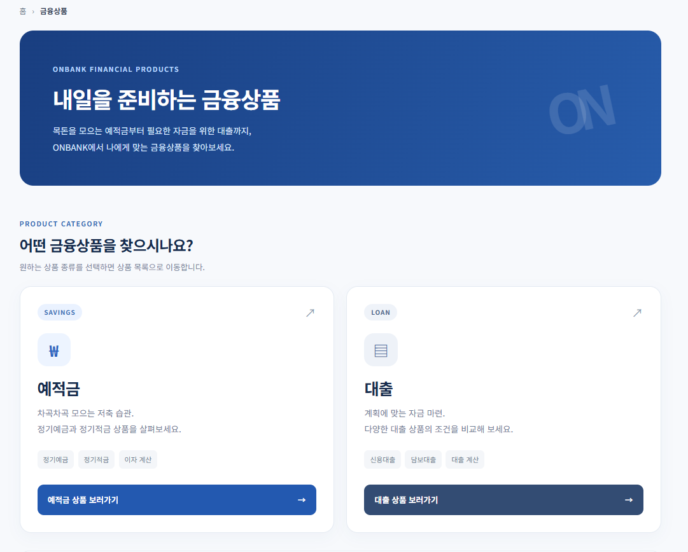

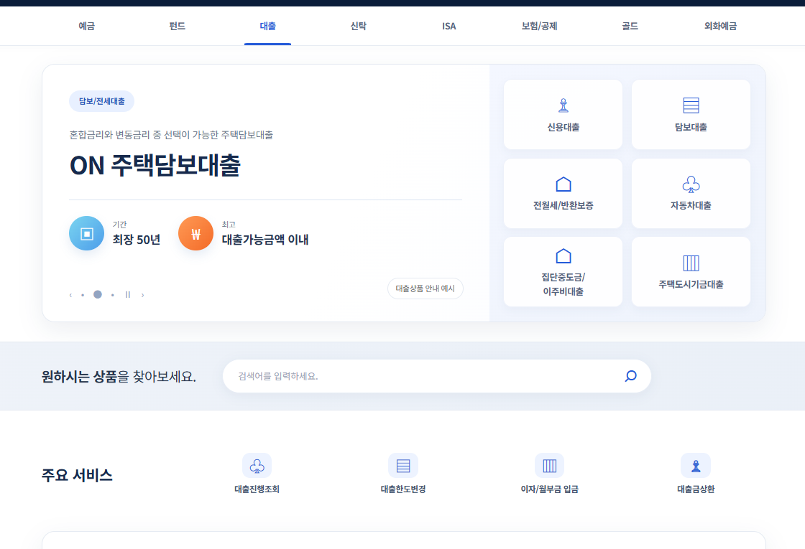

### 대출 신청

상품 조건을 확인한 뒤 신청 금액·기간·상환 방식을 입력합니다. 대출금 수령 계좌는 로그인 회원이 보유한 입출금계좌에서 선택합니다. 계좌를 선택한 시점과 실제 대출금을 지급하는 시점을 구분했습니다.

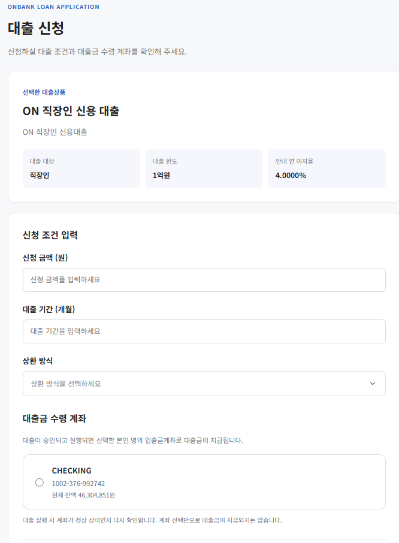

### 나의 대출 진행현황

신청별 진행 상태를 확인하고 상세 정보와 실행 결과를 조회합니다. 신청 내역을 로그인 회원 기준으로 조회하도록 연결했습니다.

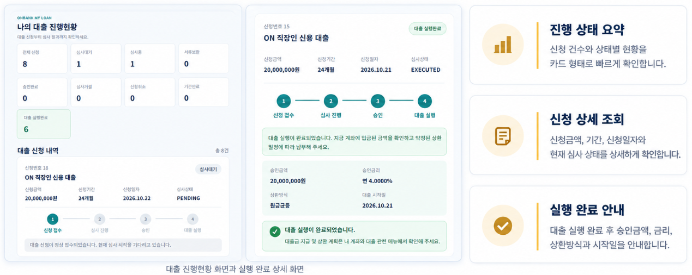

### 직원 대출 심사와 실행 결과

직원 화면에서 신청 정보와 심사 상태를 확인합니다. 승인 단계에서 확정한 조건을 실행 처리로 연결하고, 실행이 완료된 신청에는 계좌 생성·지급 결과를 표시합니다.

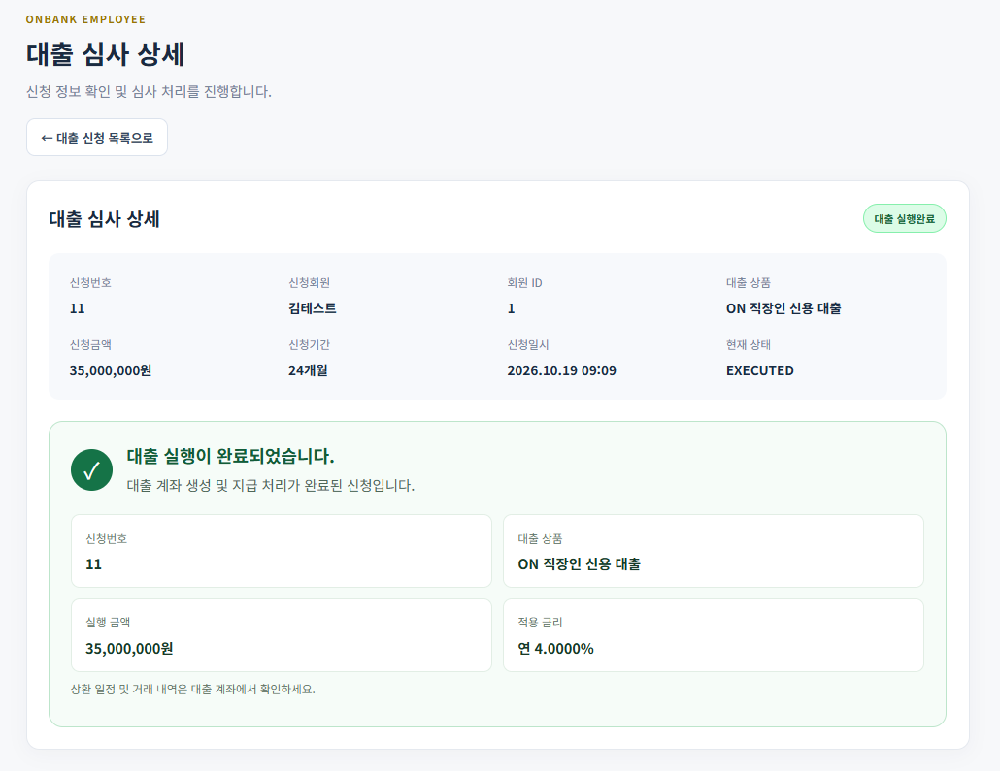

### 대출금 상환

대출 계좌별 남은 원금·최초 대출금·적용 금리를 확인합니다. 회차별 원금과 이자, 총 납부액, 납부 상태를 표시하고 선택한 회차의 상환 금액을 미리 확인할 수 있도록 구성했습니다.

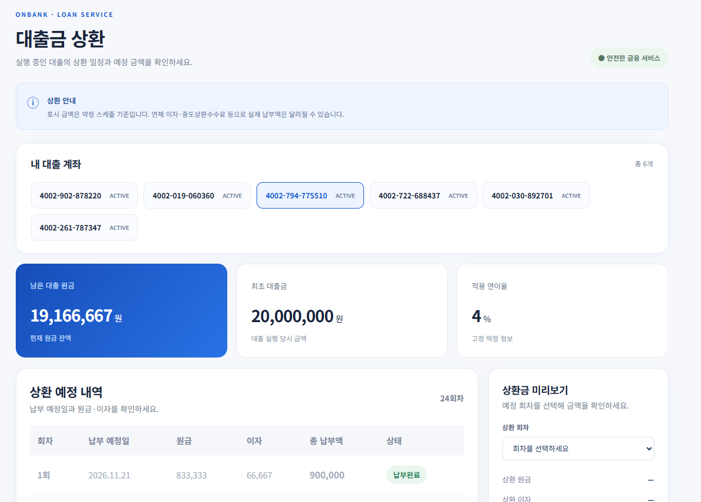

### 예적금 가입과 계좌 관리

상품 조건 확인부터 출금 계좌 선택, 가입 후 납입 일정 조회, 해지 안내까지 연결했습니다.

예적금 구현 화면 5장 보기

#### 예적금 서비스 메인

정기예금과 정기적금의 상품 탐색, 가입 계좌 조회, 신규 가입 진입을 제공합니다.

#### 상품 상세와 가입

가입 기간·납입 범위·금리를 확인하고 출금 계좌와 첫 납입액을 지정합니다.

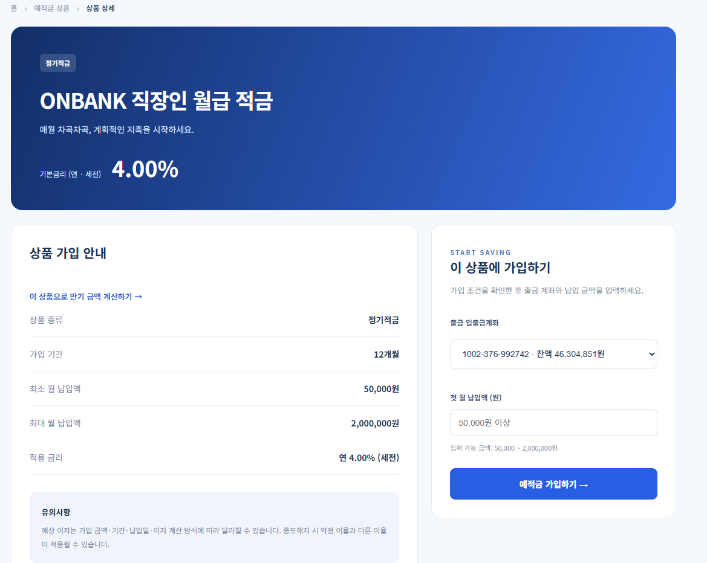

#### 정기 납입 일정

계좌별 납입 회차, 예정일, 실제 납입일과 상태를 함께 조회합니다.

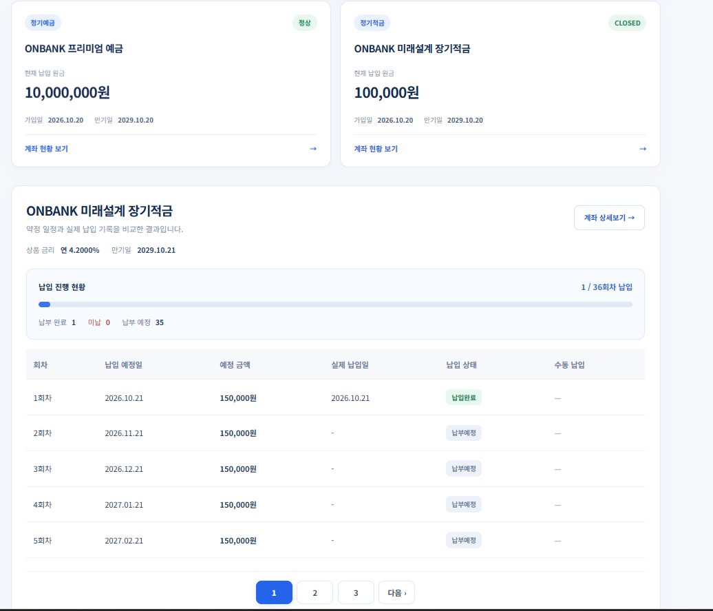

#### 예금 계좌 상세

원금·약정 금리·가입일·만기일·연결 계좌 등 계약 정보를 표시합니다.

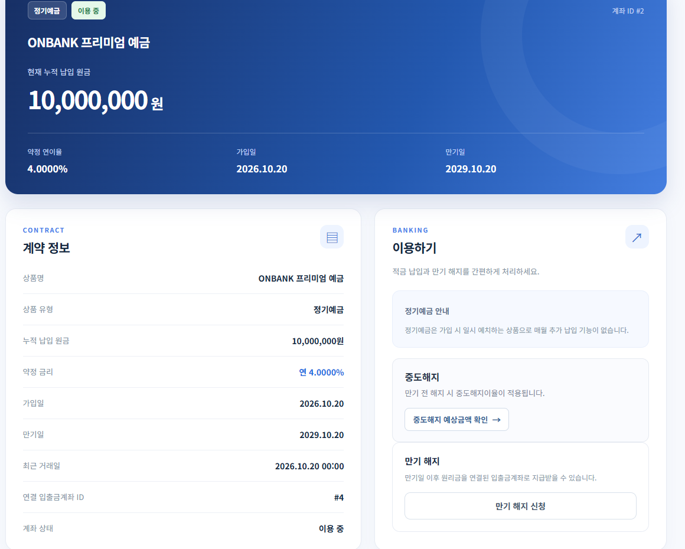

#### 중도해지 안내

중도해지 시 적용 금리·세금·예상 지급액을 확인할 수 있도록 구성했습니다. 만기 해지와 중도해지를 구분해 안내합니다.

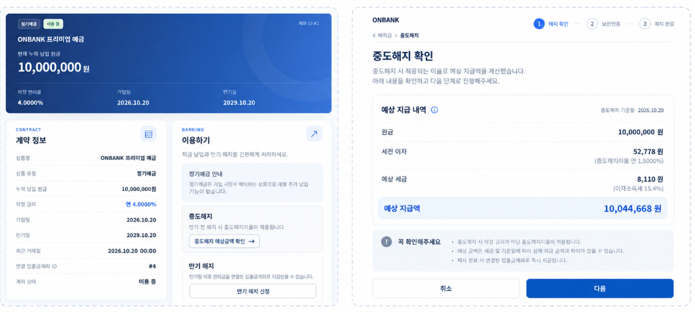

## 대출 업무 흐름

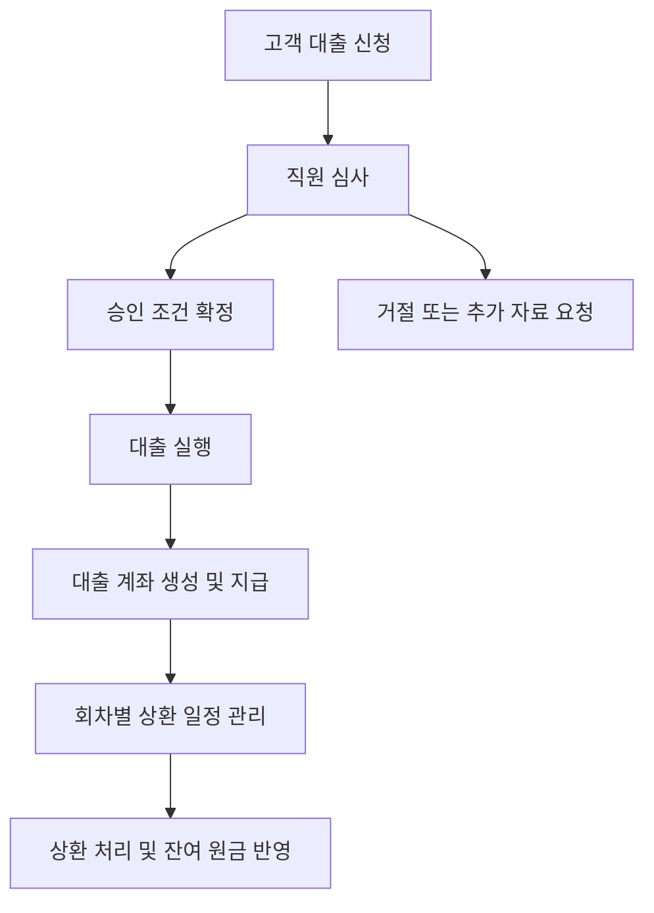

### 신청과 심사 상태

| 상태 | 의미 |
| --- | --- |
| `PENDING` | 신청 접수 |
| `REVIEWING` | 직원 심사 진행 |
| `ADDITIONAL_INFO` | 추가 자료 요청 |
| `APPROVED` | 대출 승인 |
| `REJECTED` | 심사 거절 |
| `CANCELLED` | 신청 취소 |
| `EXPIRED` | 신청·승인 유효기간 만료 상태 |
| `EXECUTED` | 대출 실행 완료 |

신청 상태와 상환 회차 상태는 별도로 관리합니다. 상환 일정에서는 `PENDING`으로 납부 예정, `PAID`로 납부 완료, `OVERDUE`로 연체 상태를 구분합니다.

## 백엔드 설계

### 1. 신청 정보와 실행 계좌 분리

대출 신청은 심사와 승인 조건을 보관하고, 대출 계좌는 실행 이후 원금과 상환 정보를 관리합니다. 신청 시 선택한 입출금계좌는 대출금을 받는 계좌로 사용합니다.

| 도메인 | 역할 |
| --- | --- |
| `Member` | 신청 회원과 계좌 소유자 식별 |
| `LoanProduct` | 상품 종류와 신청 조건 관리 |
| `LoanApplication` | 신청 정보, 심사 상태, 승인 조건, 지급 계좌 보관 |
| `LoanAccount` | 실행된 대출의 계좌와 원금 잔액 관리 |
| `LoanRepaymentSchedule` | 회차별 납부일, 원금, 이자, 납부 상태 관리 |
| `Account` | 대출금을 수령하거나 상환금을 출금하는 입출금계좌 |
| `AccountTransaction` | 계좌의 자금 이동 이력 기록 |

위 표는 도메인별 책임을 정리한 내용입니다. 실제 필드명과 테이블 매핑은 프로젝트 소스를 기준으로 합니다.

### 2. 로그인 회원 기준 조회

로그인 사용자 정보에서 회원 ID를 가져와 신청 데이터에 연결했습니다. 신청 번호만으로 조회하지 않고 회원 식별 조건을 함께 사용해 본인의 신청 내역을 찾도록 구성했습니다. 지급 계좌 선택도 회원 소유 계좌를 기준으로 처리합니다.

### 3. 승인과 실행 단계 구분

승인은 금액·금리 등 대출 조건을 확정하는 단계이고, 실행은 대출 계좌를 만들고 실제 지급 데이터를 처리하는 단계입니다. 실행 서비스에서는 승인 상태를 확인하고 후속 처리를 진행하도록 구성했습니다.

서비스 계층의 `@Transactional`과 신청 조회의 `PESSIMISTIC_WRITE` 잠금을 사용해 상태 변경을 다룹니다. 잠금 적용만으로 모든 중복 요청이 방지되는 것은 아니므로, 실행·상환 요청의 재처리 검증은 별도 확인 과제로 관리합니다.

### 4. 회차별 상환 스케줄

승인 금액과 금리, 대출 기간, 상환 방식을 기준으로 회차별 원금·이자·총 납부액과 잔여 원금을 계산합니다. 금액 계산에는 `BigDecimal`을 사용합니다.

| 상환 방식 | 코드 | 계산 기준 |
| --- | --- | --- |
| 원리금균등상환 | `EQUAL` | 매월 원리금 합계가 일정하도록 계산 |
| 원금균등상환 | `PRINCIPAL` | 매월 원금을 균등하게 나누고 잔여 원금에 이자 계산 |
| 만기일시상환 | `BULLET` | 기간 중 이자를 납부하고 마지막 회차에 원금 상환 |

계산 전에 금액·기간·금리·상환 방식의 유효성을 검증합니다. 상환 회차에는 예정 정보와 납부 상태를 저장해 조회 화면에서 함께 확인하도록 연결했습니다.

### 5. 예정 정보와 실제 처리 상태 구분

예적금 납입과 대출 상환은 예정일만 표시하는 데서 끝나지 않도록 구성했습니다. 회차별 예정 금액과 실제 납부 여부를 구분하고 계좌 잔액, 거래 기록, 상태 정보가 업무 흐름 안에서 연결되도록 설계했습니다.

## 개발 과정에서 점검한 문제

| 문제 | 확인·점검 내용 |
| --- | --- |
| Thymeleaf 템플릿을 찾지 못하는 오류 | 컨트롤러 반환 경로와 `templates` 하위 파일 위치 대조 |
| 대출 실행 요청의 HTTP 405 오류 | 폼의 전송 방식과 컨트롤러의 `@PostMapping` 경로 확인 |
| 직원 심사 화면의 접근 오류 | 로그인 주체, 직원 식별 정보, 역할 조건 확인 |
| JPA 스키마 검증 실패 | `remaining_balance` 등 엔티티 필드와 실제 DB 컬럼 대조 |
| MySQL 테이블명 매핑 문제 | 테이블명 대소문자와 물리 네이밍 전략 확인 |
| 본인 신청 조회 조건 변경 | 사용자명 중심 조회를 회원 ID 기준 조회로 정리 |

## 추가 검증과 개선 과제

아래 항목은 현재 문서에서 완료를 주장하지 않는 검증·개선 과제입니다.

- 실행 요청을 동시에 보내도 계좌 생성과 지급이 한 번만 이루어지는지 통합 테스트
- 같은 상환 회차를 재요청했을 때 중복 출금과 중복 납부 상태 변경을 막는지 검증
- 계좌 생성·지급·스케줄 저장 도중 실패할 경우 트랜잭션 롤백 확인
- 마지막 회차의 반올림 차액과 최종 잔액 0원 검증
- 다른 회원의 신청·계좌·상환 내역 접근 차단 테스트
- 연체 이자, 중도상환 수수료, 휴일 납부일 정책 확장

## 프로젝트를 통해 배운 점

금융 기능은 신청 화면을 만드는 것만으로 완성되지 않고, 심사 결과가 계좌 생성과 거래 기록, 상환 일정까지 일관되게 이어져야 한다는 점을 배웠습니다. 특히 승인과 실행을 구분하고 예정 내역과 실제 납부 상태를 따로 관리하면서, 상태 전이와 데이터 관계를 먼저 설계하는 중요성을 체감했습니다.

